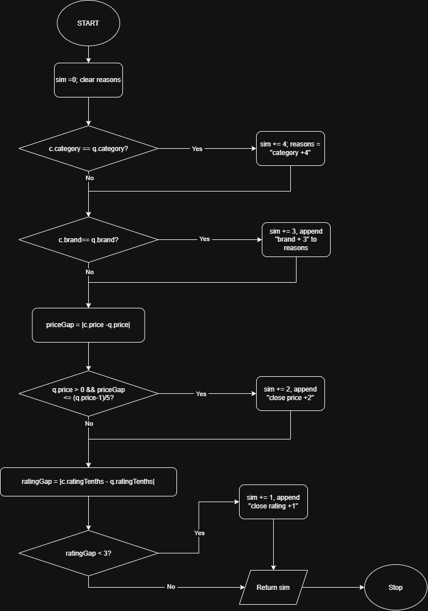

# T07 – similarity(q, c, reasons)

Input: `q` (query product), `c` (candidate product).

Output: Returns `sim`, an integer similarity score from 0 to 10, and updates
`reasons` by reference with the criteria that earned points.



Pseudocode:

```text
START similarity(q, c, reasons)
    SET sim = 0
    SET reasons = empty string

    IF c.category = q.category THEN
        SET sim = sim + 4
        SET reasons = "category +4"
    END IF

    IF c.brand = q.brand THEN
        SET sim = sim + 3
        ADD "brand +3" to reasons
    END IF

    SET priceGap = absolute difference between c.price and q.price

    IF q.price > 0 AND priceGap <= (q.price - 1) DIV 5 THEN
        SET sim = sim + 2
        ADD "close price +2" to reasons
    END IF

    SET ratingGap = absolute difference between c.ratingTenths and q.ratingTenths

    IF ratingGap < 3 THEN
        SET sim = sim + 1
        ADD "close rating +1" to reasons
    END IF

    RETURN sim
END
```

`DIV` means integer division. Each `ADD` appends `", "` first if `reasons`
already contains text, then appends the new reason.
